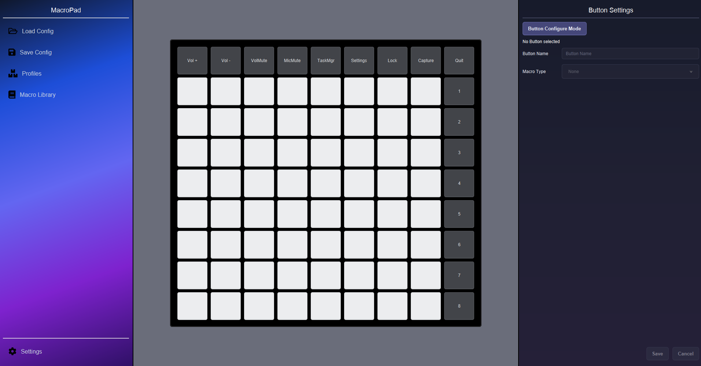

# MacroPad - Early Alpha

A customizable macro pad application for the **Novation Launchpad X**, built with Java 21 and JavaFX.

MacroPad allows users to configure Launchpad buttons and assign custom actions to them. It also includes a virtual Launchpad interface, making it possible to configure and test macros without connecting the physical device.

The Novation Launchpad is primarily designed for creating live music performances, such as this cover I made 10 years ago:
https://www.youtube.com/watch?v=amVjbRXMyC4

The Launchpad's layout and button arrangement reminded me of devices like the Elgato Stream Deck. This inspired me to develop MacroPad, giving Launchpad users the opportunity to repurpose their MIDI controller as a customizable macro pad.

Project Status: MacroPad is currently in early development. Features are still being implemented, and the application is not yet considered stable. 

## Preview

Early Development Preview



## Features

- **Virtual Launchpad:** Graphical 8×8 Launchpad interface.
- **MIDI Support:** Connect and interact with a physical Novation Launchpad X.
- **Button Configuration:** Assign individual names and macro types to buttons.
- **Audio Macros:** Trigger audio files using Launchpad buttons. (To be polished)
- **GIF Macros:** Assign GIF-based actions to individual buttons. (Not yet fully implemented)
- **System Macros:** Support for system-related actions. (Not yet fully implemented)
- **Page Management:** Organize macros across multiple Launchpad pages.
- **Configuration Mode:** Edit button settings through the graphical interface.

## Technologies

- Java 21
- JavaFX
- Maven
- MIDI

## Getting Started

### Requirements

- Java JDK 21 or newer
- Maven
- Novation Launchpad X (optional, for physical MIDI interaction)

### Installation

1. Clone the repository:

   ```bash
   git clone https://github.com/YOUR_USERNAME/MacroPad.git
   ```

2. Navigate to the project directory:

   ```bash
   cd MacroPad
   ```

3. Build the project using Maven:

   ```bash
   mvn clean package
   ```

4. Run the application using your IDE or the configured Maven JavaFX run command.

## Usage

1. Start the MacroPad application.
2. Use the virtual Launchpad interface or connect a physical Launchpad X.
3. Activate **Button Configure Mode**.
4. Select a button on the Launchpad.
5. Assign a button name and choose a macro type.
6. Configure the required settings and save your changes.
7. Deactivate configuration mode and use the button to execute its assigned macro.

